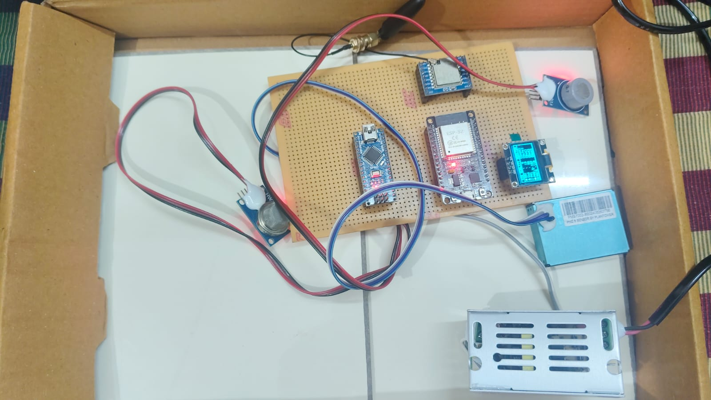
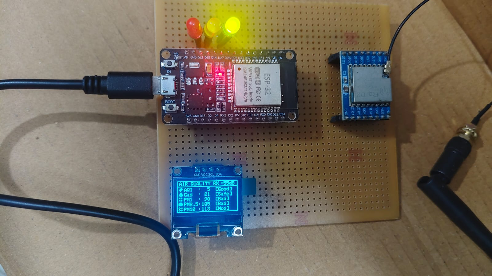
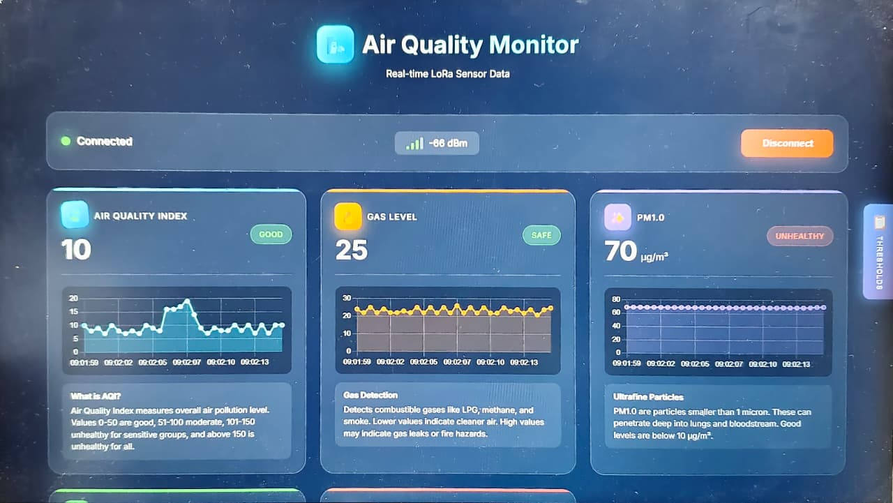
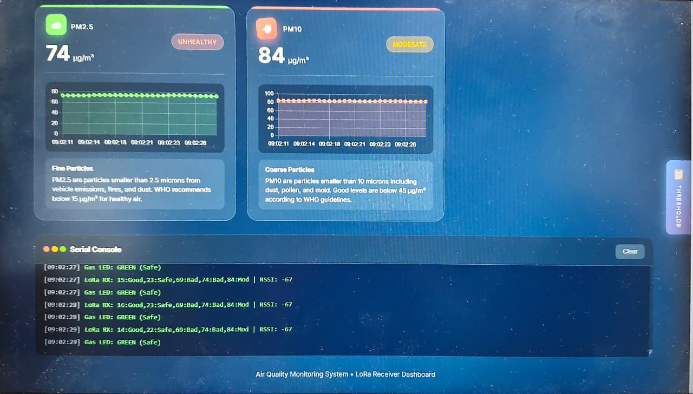
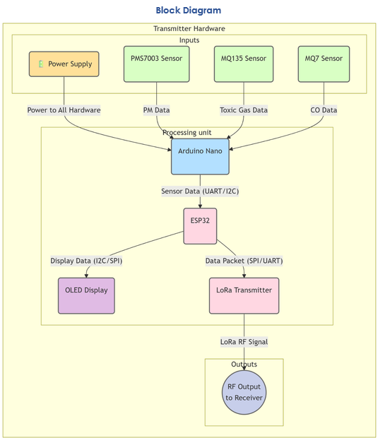
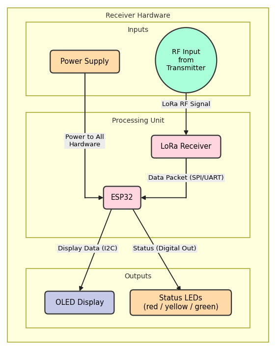

# LoRa-Based Air Pollution Monitoring System

A low-cost, two-unit air quality monitor. A sensor node measures gases and dust and sends the readings over **LoRa**. A receiver node shows them on an OLED display, status LEDs and a live browser dashboard.

> Final-year ECE project (Phase 2), Jerusalem College of Engineering, April 2026. Team project (3 members).

## Prototype

### Transmitter unit


*Sensor node on perfboard: Arduino Nano, ESP32, Ra-02 LoRa module with antenna, OLED, MQ-series gas sensors, PMS7003 dust sensor and a power supply module.*

### Receiver unit


*Receiver on perfboard: ESP32, Ra-02 LoRa module with antenna, OLED showing AQI, gas, PM1, PM2.5 and PM10 with a status tag for each, and red / yellow / green LEDs.*

### Live dashboard




*Browser dashboard titled "Air Quality Monitor: Real-time LoRa Sensor Data". It shows connection status, signal strength (dBm), live charts and a serial console of received packets.*

## System design



*Transmitter block diagram: the PMS7003, MQ-135 and MQ-7 sensors feed the Arduino Nano, which passes the data to the ESP32. The ESP32 drives the OLED and the LoRa transmitter.*



*Receiver block diagram: the LoRa receiver passes each data packet to the ESP32, which drives the OLED display and the status LEDs.*

## How it works

1. **Sense:** An Arduino Nano reads an MQ-135 (air quality) and an MQ-7 (carbon monoxide) on analog pins, and a PMS7003 particulate sensor over serial.
2. **Pack:** The Nano sends one comma-separated line to an ESP32 every 500 ms: `airQuality,Gas,pm1,pm2_5,pm10,`
3. **Transmit:** The sensor node sends the readings over LoRa (Ra-02 module).
4. **Receive and display:** The receiver node labels each reading (for example Good, Safe, Moderate, Bad), shows it on the OLED with the signal strength, and lights the LED indicators.
5. **Monitor:** A browser dashboard shows the live values, charts and received packets.

## Hardware

| Part | Used for |
|---|---|
| Arduino Nano | Reads the sensors and sends the data packet |
| ESP32 (2 units) | Parses the data, drives the OLED / LEDs, handles the LoRa module |
| Ra-02 LoRa module (2 units) | Long-range, low-power wireless link |
| MQ-135 | Air quality / harmful gases |
| MQ-7 | Carbon monoxide |
| PMS7003 | Particulate matter (PM1.0, PM2.5, PM10) |
| 0.96" OLED (SSD1306, I2C) | Local display |
| Red, yellow, green LEDs | Status indicators |
| Power supply module | Powers the transmitter unit |

## Firmware in this repository

```
firmware/
  arduino_nano_sensor_node/arduino_nano_sensor_node.ino
  esp32_oled_display/esp32_oled_display.ino
```

- **`arduino_nano_sensor_node`** reads the MQ-135 (A0), MQ-7 (A1) and PMS7003 (pins 2 and 3), then sends the data packet over serial at 115200 baud.
- **`esp32_oled_display`** receives that packet on the ESP32's second UART (RX = GPIO16, TX = GPIO17) and splits the values. It uses two **FreeRTOS tasks**, one that reads the serial data and one that refreshes the OLED every second, with a **mutex** protecting the shared sensor data. The OLED runs on I2C (SDA = GPIO21, SCL = GPIO22, address 0x3C).

**Libraries:** Adafruit GFX, Adafruit SSD1306, PMS7003-SOLDERED.
**Boards:** Arduino Nano, ESP32 Dev Module.

## Observations

- Signal strength (RSSI) was between about **-53 dBm and -86 dBm** across test sessions.
- A sample dashboard reading showed **PM2.5 = 74 µg/m³** and **PM10 = 84 µg/m³**.
- The MQ-135 and MQ-7 values are **raw analog readings (0 to 1023)**, not calibrated ppm. The "AQI" and "Gas" labels on the display refer to these raw values.

## Still to be added

- LoRa transmit and receive sketches
- Dashboard source file
- Sensor calibration to convert raw readings into ppm

## Concepts used

LoRa / LPWAN, UART serial communication, I2C, analog sensor interfacing, FreeRTOS tasks and mutexes, embedded C/C++ (Arduino framework).
